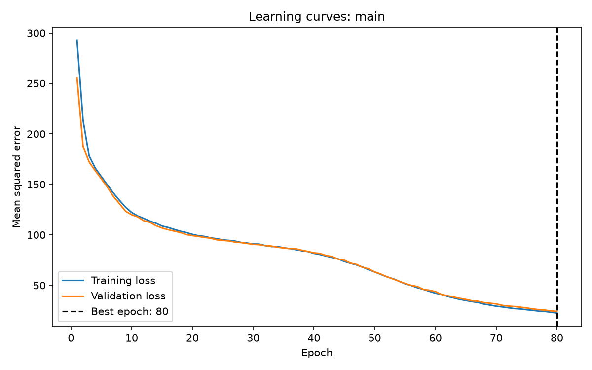
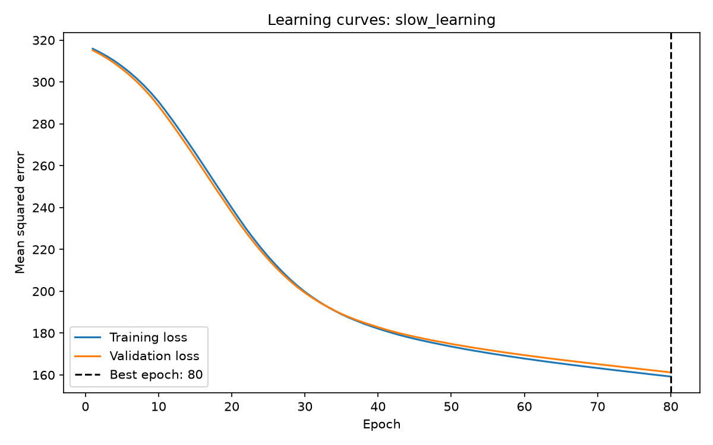
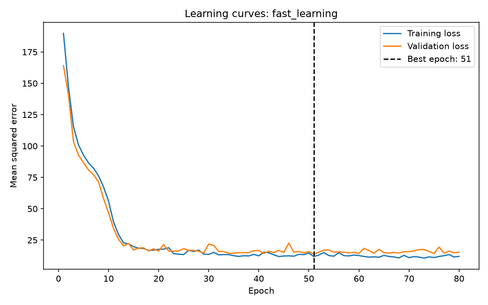

# Lakeshore Bike Demand

## What it does

This project predicts how many bikes will be rented from a Lakeshore Bike Share station during the coming hour. It uses a neural network written in PyTorch and compares its predictions with a training-mean baseline and linear regression.

## How to run it

Clone the repository and enter the project folder:

```bash
git clone https://github.com/whois-tc/lab07-first-principles.git
cd lab07-first-principles
```

Create and activate the Conda environment:

```bash
conda env create -f environment.yml
conda activate lab07-first-principles
```

Recreate every experiment, metric and image:

```bash
python train.py
```

Run the project checks:

```bash
python -m ruff format --check .
python -m ruff check .
python -m pytest
```

## Data and split

`bikes_data.py` generates 6,000 repeatable station-hour records using seed 2026. Each row contains the hour, temperature, rain, wind speed, weekend status, station type and number of bike rentals.

The rows are divided before preprocessing:

- 60% training: 3,600 rows
- 20% validation: 1,200 rows
- 20% test: 1,200 rows

The numeric scaler and station-type encoder are fitted only on the training rows. The fitted preparation is then applied to the validation and test rows. This prevents information from the validation or test sets from leaking into training.

The average rental pattern has two clear peaks around morning and evening commuting hours rather than following one straight line.


## Model and training

The network receives eight prepared inputs: five scaled numeric features and three encoded station-type values. It contains:

- a hidden layer with 64 values
- ReLU
- a hidden layer with 32 values
- ReLU
- one output value with no activation

The output represents the predicted number of rentals. Training uses mean squared error, the Adam optimizer, batches of 64 rows and 80 epochs.

The training loop was written directly in PyTorch and visibly performs:

```python
optimizer.zero_grad()
loss.backward()
optimizer.step()
```

Every run uses seed 2026 for PyTorch and the training `DataLoader`. Training loss, validation loss and validation MAE are recorded after every epoch. The model weights from the epoch with the lowest validation loss are restored before evaluation.

## Results

The final network was selected using validation performance only. The untouched test rows were evaluated after selection.

| Model | Validation MAE | Test MAE |
|---|---:|---:|
| Training mean baseline | 9.95 | 9.85 |
| Linear regression | 9.03 | 8.76 |
| Neural network | **2.47** | **2.39** |

MAE is measured in bike rentals. The neural network’s test predictions were wrong by approximately 2.39 rentals on average, substantially outperforming both baselines.

Linear regression slightly improved on predicting the training mean, but it could not adequately represent the two nonlinear demand peaks visible in the hourly plot.

The main run’s training and validation losses remained close together and continued falling through epoch 80. This indicates that the model was learning without clear overfitting, although the learning rate was too low for it to finish converging within 80 epochs.



## Experiments

Each experiment changed only the learning rate. The architecture, data split, batch size and number of epochs remained unchanged.

| Run | Learning rate | Best epoch | Best validation MAE | Final training loss | Final validation loss |
|---|---:|---:|---:|---:|---:|
| Main | 0.001 | 80 | 3.36 | 22.55 | 24.19 |
| Slow learning | 0.00005 | 80 | 8.53 | 159.26 | 161.25 |
| Fast learning | 0.01 | 51 | **2.47** | **12.05** | **15.39** |

The slow-learning run was underfitting. Its training and validation losses were still high and falling at epoch 80, showing that its very small learning rate did not allow the network to learn quickly enough.



The fast-learning run reduced loss much more quickly and reached a stable region after approximately 20 epochs. Its training and validation curves remained reasonably close, with some validation fluctuation but no sustained separation indicating serious overfitting. It achieved its lowest validation loss at epoch 51, so its weights from that epoch were restored and it was selected as the final network.



The main run also learned steadily, but it had not reached the performance of the fast-learning run by epoch 80. These results show that the original architecture was capable of learning the problem, but the learning rate strongly affected how quickly it reached a useful solution.

## Limitations

The dataset is invented and does not represent actual Lakeshore Bike Share customers or stations. The model cannot account for holidays, special events, station capacity, current bike availability, service disruptions or changes in travel behaviour.

The predictions show expected rental demand, not why demand occurs. Planners should not use the model alone to make staffing, purchasing or station-removal decisions without real operational data and human review.