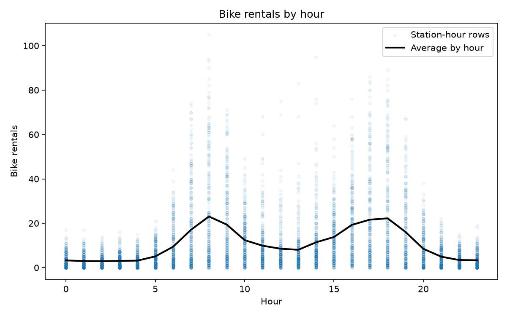
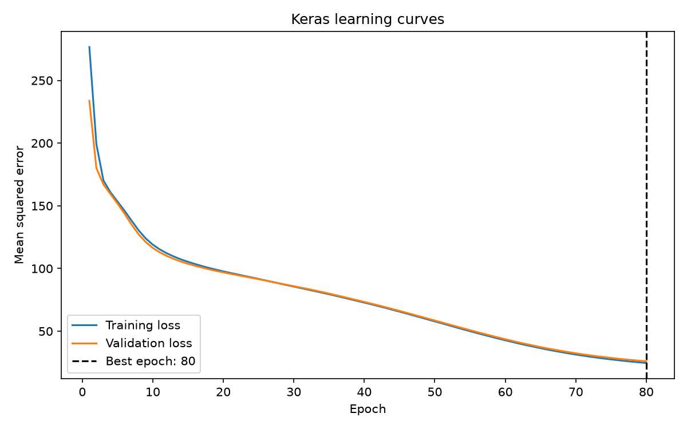

# Lakeshore Bike Demand: the same model in PyTorch and Keras

## What it does

This project predicts how many bikes will be rented from a Lakeshore Bike Share station during the coming hour. The same neural-network architecture is implemented in PyTorch and Keras so their accuracy, training time and development workflows can be compared fairly.

Both frameworks use the same prepared rows, features, targets, architecture and training settings. The repository also retains the training-mean and linear-regression baselines from Lab 7.

## How to run it

Clone the repository and enter the project folder:

```bash
git clone https://github.com/whois-tc/lab08-same-model-twice.git
cd lab08-same-model-twice
```

Create and activate the Conda environment:

```bash
conda env create -f environment.yml
conda activate lab08-same-model-twice
```

Recreate the original PyTorch reports:

```bash
python train.py
```

Recreate the Keras training history and learning curve:

```bash
python train_keras.py
```

Run the three-seed comparison of both frameworks:

```bash
python compare.py
```

Run all project checks:

```bash
python -m ruff format --check .
python -m ruff check .
python -m pytest
```

The Keras training scripts create model checkpoints inside `models/`. This directory is ignored by Git because the binary models can be recreated by running the scripts. The CSV and PNG reports are committed.

## Data and split

`bikes_data.py` generates 6,000 repeatable station-hour records using seed 2026. Each row contains the hour, temperature, rain, wind speed, weekend status, station type and number of bike rentals.

The rows are divided before preprocessing:

- 60% training: 3,600 rows
- 20% validation: 1,200 rows
- 20% test: 1,200 rows

The numeric scaler and station-type encoder are fitted only on the training rows. The fitted preprocessing is then applied to the validation and test rows. This prevents information from the validation or test sets from leaking into training.

`prepare.py` creates the prepared NumPy arrays and PyTorch datasets. Keras receives those same arrays rather than performing a separate split or preprocessing process.

The average rental pattern has two clear peaks around morning and evening commuting hours rather than following one straight line.



## Model and training

Both networks receive eight prepared inputs: five scaled numeric features and three encoded station-type values. Each network contains:

- a hidden layer with 64 values
- a ReLU activation
- a hidden layer with 32 values
- a ReLU activation
- one output value with no activation

The output represents the predicted number of rentals.

The fair main configuration uses:

- mean squared error loss
- Adam optimizer
- learning rate of 0.001
- batch size of 64
- 80 epochs

The PyTorch loop explicitly performs:

```python
optimizer.zero_grad()
loss.backward()
optimizer.step()
```

It records training loss, validation loss and validation MAE after every epoch. It also restores the weights from the epoch with the lowest validation loss.

The Keras version performs the equivalent work through `compile` and `fit`. Its `EarlyStopping` callback restores the best weights, while `ModelCheckpoint` saves the best model.

## Results

The original Lab 7 experiments selected a PyTorch model using validation performance only. The untouched test rows were evaluated after selection.

| Model | Validation MAE | Test MAE |
|---|---:|---:|
| Training mean baseline | 9.95 | 9.85 |
| Linear regression | 9.03 | 8.76 |
| Neural network | **2.47** | **2.39** |

MAE is measured in bike rentals. The selected neural network’s predictions were wrong by approximately 2.39 rentals on average, substantially outperforming both baselines.

The selected Lab 7 network used a learning rate of 0.01. The framework comparison uses the required main configuration with a learning rate of 0.001 for both frameworks, so its results are not expected to match the selected fast-learning experiment.


## Experiments

The original PyTorch experiments changed only the learning rate. The architecture, data split, batch size and number of epochs remained unchanged.

| Run | Learning rate | Best epoch | Best validation MAE | Final training loss | Final validation loss |
|---|---:|---:|---:|---:|---:|
| Main | 0.001 | 80 | 3.36 | 22.55 | 24.19 |
| Slow learning | 0.00005 | 80 | 8.53 | 159.26 | 161.25 |
| Fast learning | 0.01 | 51 | **2.47** | **12.05** | **15.39** |

The slow-learning run was underfitting because its small learning rate did not allow it to learn quickly enough. The fast-learning run reduced loss more quickly and achieved its lowest validation loss at epoch 51.


## The Keras version

`keras_model.py` rebuilds the PyTorch architecture using the Keras functional API. Its hidden-layer sizes remain configurable.

The equivalence check copies every PyTorch linear layer into the corresponding Keras Dense layer. The weight matrices are transposed because PyTorch stores them as `(outputs, inputs)`, while Keras stores them as `(inputs, outputs)`. After the copy, both networks produce matching predictions within a tolerance of `1e-5`.

The Keras main run records every epoch in `reports/history_keras.csv` and saves its learning curve:



The fair comparison trained the main configuration in both frameworks using three seeds:

| Framework | Seed | Best epoch | Validation MAE | Test MAE | Seconds |
|---|---:|---:|---:|---:|---:|
| PyTorch | 2026 | 80 | 3.3570 | 3.2140 | 8.09 |
| Keras | 2026 | 80 | 3.5384 | 3.4617 | 11.48 |
| PyTorch | 2027 | 80 | 4.2958 | 4.0295 | 7.21 |
| Keras | 2027 | 80 | 3.5427 | 3.3496 | 11.46 |
| PyTorch | 2028 | 80 | 4.5080 | 4.2053 | 6.92 |
| Keras | 2028 | 80 | 4.8177 | 4.5327 | 11.28 |

Keras averaged a test MAE of 3.78 rentals, while PyTorch averaged 3.82. This difference is too small and inconsistent across seeds to establish a clear accuracy winner.

PyTorch averaged 7.41 seconds per run, compared with 11.41 seconds for Keras. The recommendation and supporting evidence are explained in [COMPARISON.md](COMPARISON.md).

## Tests

The test suite keeps all Lab 7 tests and adds coverage for:

- configurable Keras network shapes
- matching PyTorch and Keras parameter counts
- equivalent predictions after weight copying
- identical prepared arrays for both frameworks
- memorizing a small batch
- saving and reloading a Keras model
- restoring the best validation weights
- repeating a short run with the same seed
- required comparison rows and CSV columns

The current suite collects 28 test cases. At least one test is parametrized across several hidden-layer configurations.

Run the suite with:

```bash
python -m pytest
```

## Limitations

The dataset is invented and does not represent actual Lakeshore Bike Share customers or stations. The model cannot account for holidays, special events, station capacity, current bike availability, service disruptions or changes in travel behaviour.

The framework comparison used only three seeds, one computer and one relatively small regression network. The timing results should not be generalized to GPU training, larger datasets or pretrained models without further measurement.

All six comparison runs reached their best validation loss at epoch 80. This suggests the main configuration may still have been improving when training ended.

The predictions show expected rental demand, not why demand occurs. Planners should not use the model alone to make staffing, purchasing or station-removal decisions without real operational data and human review.